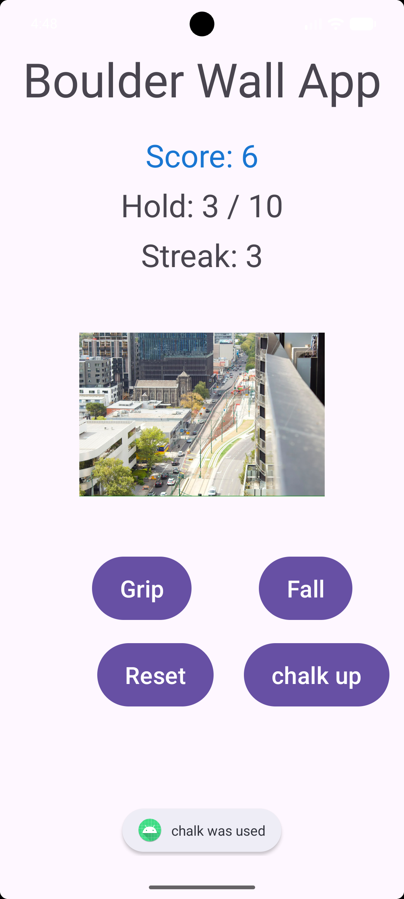
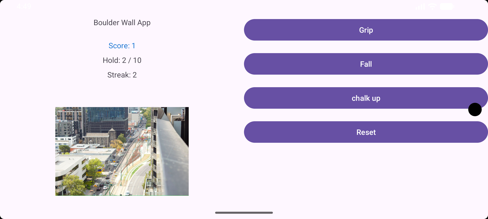
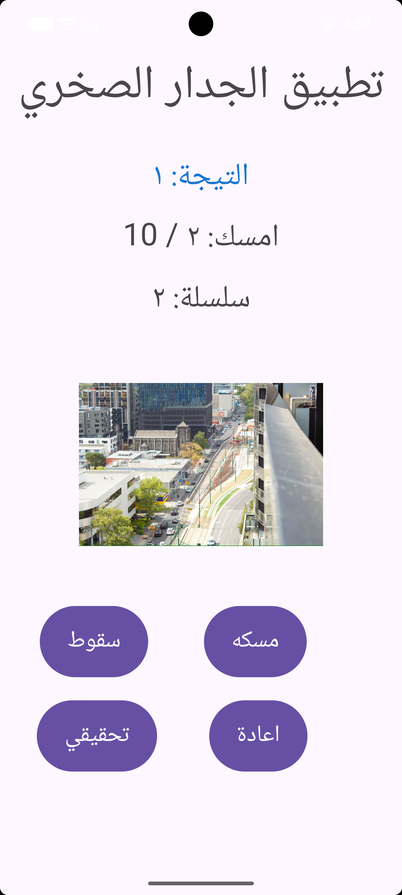

# 🧗 Boulder Wall: Climbing Route Tracker

**A native Android app for scoring a 10-hold bouldering route in real time, built with Kotlin.**

The climber (or a judge) taps **Grip** for each hold reached, **Fall** for a fall, and **Chalk Up** once per climb. The app keeps the score, the current hold and the combo streak, colours the score by zone, and announces when the route is complete. It works in portrait and landscape, keeps its state when the phone rotates, and is fully translated into Arabic.

> 🔒 **The source code is private** (university coursework). This repository shows the project and how it works. The code is available on request: get in touch and I'll add you to the private repository.

---

## Screenshots

| Portrait | Landscape | Arabic (RTL) |
|:---:|:---:|:---:|
|  |  |  |

---

## How the scoring works

| Rule | Detail |
|---|---|
| **Zones** | Holds 1–3 are worth **2** points (blue), holds 4–7 are worth **3** (green), and holds 8–10 are worth **4** (orange). The score text changes colour to match the zone. |
| **Combo bonus** | Every 4th grip in a row earns an extra **+1** point. |
| **Fall** | Takes away **3** points (never below 0) and ends the attempt, so no more grips count. |
| **Chalk Up** | Can be used **once** per climb, only after starting and before a fall. A toast confirms it. |
| **Limits** | The score is capped at **30**. After hold 10, a "Route complete!" message appears and further taps are ignored. |
| **Reset** | Clears everything and starts a new climb. |

Every ignored action (such as Grip after a fall) is guarded and logged, so the state can never become invalid.

---

## Features

- **Score, hold (x / 10) and combo streak** shown live
- **Zone colours** on the score
- **Separate landscape layout** with a two-column design
- **State survives rotation:** score, hold, streak, fall status and chalk use are saved with `onSaveInstanceState`
- **Arabic localisation** with full right-to-left support
- **Route complete** message at the top of the wall

---

## Tech stack

| Area | Tools |
|---|---|
| Language | Kotlin |
| UI | XML layouts (`ConstraintLayout`), separate `layout-land`, View Binding |
| State | `onSaveInstanceState` / `Bundle` |
| Localisation | String resources with `values-ar` (RTL) |
| Build | Gradle (Kotlin DSL), min SDK 24 |

---

## What I learned

- How Android destroys and recreates an Activity on rotation, and how to save and restore state
- Designing separate layouts for portrait and landscape
- Keeping business rules (zones, combos, caps) separate from the UI with small, testable functions
- Localising an app and supporting right-to-left languages
- Committing in small, clearly described steps (11 commits from skeleton to final features)

---

## About

Built by **Khalid Alluqmani** for a university mobile development unit, 2026.

📫 Want to see the code? Contact me and I'll grant access to the private repository.
